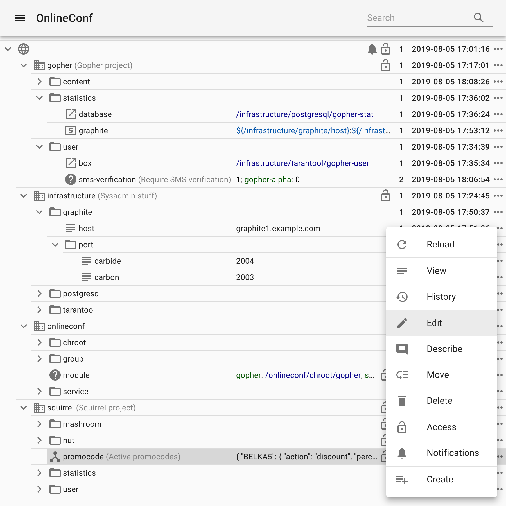

# OnlineConf

OnlineConf is an application level configuration system targeted at developers and managers of web services and applications and used to change their behavior rapidly.

OnlineConf is developed with horizontal scalability and fault tolerance in mind, and it is able to store relatively large configurations. Reading of configuration parameters by applications is done from memory mapped files organized as a constant database and it neither requires networking nor injects additional points of failure. Thanks to the index required parameters only are read from files without parsing of their whole content.

OnlineConf is developed by Mail.Ru where it is used since 2011 to configure high load projects deployed on thousands of servers.



## Features

* Configuration availability irrespective of availability of OnlineConf itself;
* Fast indexed access to parameters by applications;
* Storing a configuration structured as a tree;
* Not only text values but JSON/YAML too;
* Symbolic links to parameters (like symlinks in Unix systems);
* Conditional parameters which values depend on a hostname, datacenter or credentials of a server;
* Control panel to edit a configuration without developer, devops or system administrator skills;
* API for scripted modification of parameters;
* Access control applied to individual parameters and whole subtrees;
* Log of parameters modifications and pluggable notifications;
* [Kubernetes integration](https://github.com/onlineconf/onlineconf-csi-driver).

## Installation

### Try in Docker

Run the database, the API and the control panel:

```sh
cd admin
docker-compose up
```

The database will be initialized with the demo config, the control panel and the API will be accessible at [localhost](http://localhost).

The demo shows a relatively complex case when one installation of OnlineConf is used to control multiple unrelated projects (for just one project a structure can be simpler): *gopher* and *squirrel*. Every project is deployed on its own cluster and has its own user groups.

For demonstration purposes following users are created (passwords match usernames):

* `admin` - a user with the full access (group `root`);
* `hedgehog` - a system administrator (group `sysadmin`);
* `meerkat` - a developer of the gopher project (group `gopher-developer`);
* `rabbit` - a developer of the squirrel project (group `squirrel-developer`);
* `beaver` - a manager of the squirrel project (group `squirrel-manager`).

In this demo the relation of a managed server to a project is determined by credentials with which *onlineconf-updater* connects to *onlineconf-admin* (see branch `/onlineconf/service` of the configuration, passwords match usernames).

Run the agent which updates configuration files on a target server.

```sh
cd updater
docker-compose up
```

By default *onlineconf-updater* for the project gopher is run by `docker-compose`. To run the agent for the squirrel project credentials in [docker-compose.yml](updater/docker-compose.yml) must be fixed. Generated configuration files can be found in `./updater/data` directory on the host (mounted as `/usr/local/etc/onlineconf` in the container).

Projects gopher and squirrel are intentionally configured differently. Gopher follows the way of one logically structured config which is used by all services run on a server whereas on a server of squirrel every service has its own configuration file.

### Run in production

Building, configuring and running of `onlineconf-admin` and `onlineconf-updater` are easy enough. Information on running `onlineconf-admin` can be found in [admin/docker-compose.yml](admin/docker-compose.yml), [admin/Dockerfile](admin/Dockerfile) and [admin/SPECS/onlineconf-admin.spec](admin/SPECS/onlineconf-admin.spec). For `onlineconf-updater` see files [updater/docker-compose.yml](updater/docker-compose.yml), [updater/Dockerfile](updater/Dockerfile) and [updater/SPECS/onlineconf-updater.spec](updater/SPECS/onlineconf-updater.spec).

`onlineconf-admin` can either be placed behind reverse proxy (nginx, for example) or serve static and terminate TLS by itself. Anyway TLS MUST be used in production.

If OnlineConf is used to configure applications deployed in Kubernetes then [onlineconf-csi-driver](https://github.com/onlineconf/onlineconf-csi-driver) is recommended to use instead of *onlineconf-updater*.

## Architecture

OnlineConf consists of two components: `onlineconf-admin` and `onlineconf-updater`.

### onlineconf-admin

The main component of the system. Contains the whole logic of configurations, provides the API for editing of a configuration, the API for delivering configurations to managed servers and exposes the control panel.

To store data the MySQL database is used. It is well known by system administrators and they exactly know how to configure, replicate and backup it.
Backend of the service is written in Go, frontend in TypeScript, communication between them is done using a REST API which can be used for an automation too.

### onlineconf-updater

The daemon runs on every server configured by OnlineConf. It updates local configuration files from the data received from *onlineconf-admin*. It asks *onlineconf-admin* periodically if the configuration has changed and if so then writes a new configuration to the local files in two formats: *conf* and *cdb*.

Format *conf* is historical and used from the very first versions of OnlineConf. It can be recommended for small configurations only. This format is a plain text where each line is a key-value pair.

The recommended format is *cdb*. Its support was added when it became plain what reading a configuration from plain text files requires a lot of CPU time. CDB is documented on [the site of its author](http://cr.yp.to/cdb.html)

The daemon is written in Go, has no dependencies and easily deployed on any system.

## Data types

* Null - a key without a value, it is equal to the absence of the key;
* Text - a text, can be multiline;
* JSON - JSON-encoded field;
* YAML - a field stored, edited and viewed as YAML. Applications will receive it transcoded to JSON to simplify usage;
* Template - a text template where other parameters, a hostname/ip of a target server or variables from `variables` section of *onlineconf-updater* configuration file can be substituted;
* Symlink - a symbolic link to another parameter similar to symlinks of Unix systems;
* Case - a conditional value, works as the switch operator;
* Various types of lists: a simple comma-separated list, *ip:port* pairs separated by a comma and *ip:ports* pairs separated by a semicolon (where ports are separated by a comma).

### Encrypted values

A value of any type except Null, Symlink and Case can be marked **Encrypted**
(a Case cannot, but each of its branches can, nested Cases included). Such a
value is stored in the database as an AES-256-GCM envelope written by
`onlineconf-admin` with a key from its key file, and so is every version of
it in the change history: the moment a parameter becomes encrypted its older
versions are sealed as well. Database dumps, backups, replicas and database
accounts never see the plaintext, and neither do the admin's side channels:
value search skips encrypted values, change notifications and the bot feed
show a lock instead of the value, server logs print `<encrypted>`.

Encryption is at rest only. Managed servers keep receiving plaintext from
`/client/config` exactly as before (over TLS, which is mandatory in
production), and the resolver decrypts the whole tree in memory. It does
not protect against a compromised admin host, against users the reveal
policy admits, or against copies of the database taken before a value was
encrypted.

**Reading a secret is an explicit, audited act.** The UI and the API serve
an encrypted value as `null` in every listing; the plaintext is returned
only by `GET /config/<path>?reveal=1` (and the parameter's history by
`GET /log/<path>?reveal=1`), subject to the reveal policy (see
`/onlineconf/value-encryption/reveal` below), and every such request is
recorded in the audit log (`my_config_audit`, kinds `reveal_view` and
`reveal_history`) and announced to the parameter's owners through the bot
(`GET /botapi/audit/`, scope `audit`) and the legacy notification table.
Writing an encrypted parameter requires stating the
`encrypted` form field (`1` or `0`) explicitly: a client that does not know
about encryption is refused rather than allowed to overwrite the secret
with the `null` it was served. Rolling a parameter back to a historical
version is done server-side (`POST /config/<path>` with `version` and
`restore=<version>`) and never downgrades encryption.

**Configuration.** The key file is a text file with one
`<key-id> <base64 of 32 random bytes>` per line (`#` comments allowed); a
fresh installation encrypts with the first key, and from then on with the
key the registry records as active (see *Rotation* below), whatever the
file's order; every other key is kept for decryption. Generate a key with `head -c 32 /dev/urandom | base64`, keep the
file readable by the service user only, and point the admin to it:

```yaml
encryption:
  key_file: /usr/local/etc/onlineconf-admin.keys
```

or set the `ONLINECONF_ENCRYPTION_KEY_FILE` environment variable (the
Docker image maps it to the same setting). The startup log always states
the outcome: `encryption keyring loaded` with the active key id, or `value
encryption is not configured` — a key file that merely exists at
`/usr/local/etc/onlineconf-admin.keys` is reported but never loaded
implicitly. Without a key the UI offers no *Encrypted* switch and
`/ui-config` reports `"encryption": {"enabled": false, "reveal": "rw"}`
(`reveal` being the policy below). An instance that finds
encrypted values in the database without a key file, or a key whose material
differs from the one registered in the database under the same id, refuses
to start; one that cannot decrypt a value at reload keeps serving its last
good configuration. Every instance of an installation must have the same
keys.

**Rotation** needs no tool, only the key file and one restart. Add the new
key to the key file on every instance — on any line: the file's order
matters on a fresh installation only — and restart them. Once every
instance holds it, write its id to `/onlineconf/value-encryption/key-id`:
the instance handling that write (any other within seconds, through its
tree reloads) re-encrypts every stored value in the background without
touching versions, timestamps or notifications, and records the new key as
active in the key registry (`my_config_encryption_key`).
`GET /encryption-status` (root users only) reports the wanted key, the key
this instance encrypts with, and the sweep; once it reports the sweep done,
delete the old key from the files at any later deploy. A key that was
active once cannot become active again: rotate forward. An id written
before every instance holds the key is refused by the instances without it
(logged, nothing changes on them), and after the sweep they cannot decrypt
what the others wrote until they get the key.

## Authentication

Right now two authentication methods are supported:

* `mysql` - credentials are stored in MySQL table. Table structure and password hashing method are inherited and compatible with module `mod_auth_mysql` of Apache httpd.

* `header` - authentication is performed by a reverse proxy deployed in front of `onlineconf-admin`. In the header parameter you can specify the name of the HTTP header that the reverse proxy will use to pass the username (by default `X-Username`, for `oauth2-proxy`, for example, you should use `X-Forwarded-Preferred-Username`). If you specify a signature salt in the `secret` parameter, then `onlineconf-admin` in the HTTP header with the name `header + "-Sign"` (that is, `X-Username-Sign` by default) will expect a signature calculated as MD5 from the concatenation of the username, the user IP and the salt. When using a reverse proxy, you also need to set the `behind_reverse_proxy` configuration parameter in the http section to true.

## Authorization

Any parameter of the tree can be configured to be readable and writable by a specific group of users. Access rights are inherited by children parameters from the parent. Any user who can edit a parameter can delegate an access to another group of users.

The system has the special group `root` which has additional capabilities such as a management of groups of users.

## The special parameters

The configuration tree of OnlineConf has the special branch `/onlineconf`. It is used to configure the behavior of OnlineConf itself and makes some interesting things possible.

### /onlineconf/module

`/onlineconf/module` is the most important branch of the tree. It is the starting point of all configurations sent to managed servers. Every child of this parameter represents a separate configuration file with the whole subtree as its content.

In the simplest case this node has exactly one child parameter `/onlineconf/module/TREE` which contains a symlink to the root of the tree. This way all managed servers receive files `/usr/local/etc/onlineconf/TREE.{cdb,conf}` containing the whole configuration tree. But more interesting cases are possible.

For example, the parameter can contain a *case* value which depending on a group of a managed server contains symlink to different subtrees. In this case managed servers from different groups will receive different configurations. This is useful to manage several projects using one installation of OnlineConf.

If several services are run on one managed server and they must have their own configuration files then `/onlineconf/module` can contain several children one for each service.

Values of parameters `/onlineconf/module` and `/onlineconf/module/${modulename}` are used by *onlineconf-updater* to customize a generation of configuration files. `/onlineconf/module` is used to configure a default behavior used for all modules whereas `/onlineconf/module/${modulename}` for a `${modulename}` only. The value must be of YAML or JSON type and contain a map of parameters.
Right now supported parameters are: `delimiter`, `owner`, `mode` and `child_lists`.

* `delimiter` is used to configure a delimiter used in names of configuration parameters. For new installations of OnlineConf it is highly recommended to configure it explicitly (in `/onlineconf/module`), in the other case the compatibility mode will be used in which the delimiter `/` will be used for the module `TREE` and the delimiter `.` for other modules.
* `owner` is used to set the owner of the config file on the target server.
* `mode` is used to set the permissions of the config file on the target server.
* `child_lists` (bool) instructs the OnlineConf server (not an updater) to send an additional parameter for every non-empty branch. The name of this parameter is the name of a branch suffixed with the `delimiter`, and the value is a JSON array containing names of child elements of the branch. If `child_lists` is missing or `false`, child lists aren't generated and sent.

### /onlineconf/service

`/onlineconf/service` contains a tree of accounts which are used by *onlineconf-updater* to authorize in *onlineconf-admin*. It also can be used as a condition in a *case*. The name of a parameter is the name of a user (or its last chunk), the value is password's SHA256. To be protected from the rainbow table attacks a password MUST be a long random string (16 characters at least).
Nested services inherit configurations from their parents allowing to override some parameters by using more specific *cases*.
A username of a nested service is a path without `/onlineconf/service/` prefix, for example, `gopher/alpha`.

### /onlineconf/group

`/onlineconf/group` groups managed servers and services by name. The name of a parameter is the name of a group, the value is a *glob* (similar to glob used in `bash`) of hostnames belonging to this group or service names with `service:` prefix (for example, `service:gopher/alpha`). Syntax of the used glob flavor is described [here](https://github.com/bmatcuk/doublestar#patterns). For example, `{alpha*.{example.com,i},service:gopher/alpha}` contains servers `alpha*.example.com` and `alpha*.i` (where `*` is any symbol except `.`) and service `gopher/alpha`.

`/onlineconf/group/priority` - a list of the groups in descending order. By default the groups are sorted alphabetically. All explicitly unspecified groups are appended to the end of the list or instead of `*` placeholder if presented. Priorities are useful in the case when one server belongs to several groups for which a parameter has different values.

### /onlineconf/datacenter

`/onlineconf/datacenter` groups servers by datacenter. The name of a child parameter is the name of a datacenter, the value can either be of `Null` type or a comma-separated list of networks of `Text` or `List` types. In the first case datacenter name will be received from *onlineconf-updater* (`datacenter` parameter in its `onlineconf.yaml` config), in the second case it will be calculated using IP address *onlineconf-updater* connected from.

### /onlineconf/suspended

`/onlineconf/suspended` suspends sending of configurations to managed servers if the value is true (the type is not `Null` and the value is not `""` and not `"0"`). Can be used to edit multiple parameters in one transaction. The beginning of a transaction is setting the parameter to true, the end - to false. It is also useful to test dangerous configuration modifications on a small subset of managed servers.

### /onlineconf/ephemeral-ip

`/onlineconf/ephemeral-ip` contains a list of networks where IP addresses are assigned dynamically and are valid only during a service lifetime (in Kubernetes cluster, for example). Reverse DNS query and monitoring are skipped for these networks.

### /onlineconf/ui/avatar

`/onlineconf/ui/avatar` contains a configuration of avatars displayed in the OnlineConf UI in JSON or YAML format with the following schema:

* `uri` - an avatar URI base, `/` and a username will be appended to it to form a URI;
* `domain` - a domain users belongs to, if present then it will be appended to usernames after `@`;
* `gravatar` - if true then a username will be hashed using MD5 before appending to a base URI;
* `extension` - a filename extension, if present then it will be appended to the URI after `.`;
* `rename` - `map[string]string`, a dictionary of replacements of usernames to use in avatar URIs;
* `link` - a configuration object of a link to a user profile:
  * `uri` - a user profile URI base, `/` and a username will be appended to it to form a URI;
  * `rename` - `map[string]string`, a dictionary of replacements of usernames to use in user profile URIs;

Symlinks in this parameter are intentionally not supported. Only JSON and YAML types are allowed.
A value of the parameter will be implicitly readable by all users through `/ui-config` API method.

### /onlineconf/botapi/bot

Direct children of `/onlineconf/botapi/bot` are users of the server-server API of OnlineConf. Names of children parameters are usernames, values are SHA256-encrypted passwords (MUST contain random 16+ characters long strings). User parameters can contain subparameter `scopes` (`/onlineconf/botapi/bot/*/scopes`) of type List which is used to allow these users access to various parts of the API.

### /onlineconf/disable-deleted-key-symlinks-check

When the parameter is being deleted by the user, a symlink/template consistency check is performed. If some symlink or template refers to this parameter (including symlinks/templates inside a **case** value),
the deletion is aborted with an error message describing referring symlinks/templates. This is a non-exhaustive check (e.g., no more than 5 nested symlinks are checked, nested **case** values aren't
supported) and should be treated as a foolproof only and not as a formal consistency guarantee. In some rare cases, like nested symlinks to the parent subtree, a noticeable delay may occur when
some parameter is deleted.

To disable this foolproof, you can set `/onlineconf/disable-deleted-key-symlinks-check` to any non-empty text value other than `0`.

### /onlineconf/value-encryption

`/onlineconf/value-encryption` enables writing encrypted values (see
*Encrypted values* above) when it holds a non-empty text value other than
`0` **and** the instance has a key file. Fresh installations get it seeded
with `1`. On an upgraded installation the parameter does not exist and the
feature stays off — applying the schema migration alone changes nothing —
until the operator creates it, once every instance runs a version that
understands encrypted values and has the key file: an older instance would
serve the stored envelope as the value. Switching it off later refuses new
encrypted writes only; reveals and declassification (`encrypted=0`) keep
working, so no parameter is ever trapped.

`/onlineconf/value-encryption/reveal` sets who may reveal an encrypted value:
`rw` (the default, also when the parameter is absent) requires write access
to the parameter, `ro` lets anyone with read access reveal it. Both
parameters are plain text read by path — symlinks are followed, access
rights are not consulted — and must not be encrypted themselves. A change
of the reveal policy takes effect at once on the instance that handled the
write, and within a few seconds, at their next tree reload, on the others.

`/onlineconf/value-encryption/key-id` — read the same way — names, by its
id in the key file, the key new encryptions use; writing a new id there is
how a key is rotated (see *Rotation* above). Which key is in use, in order
of precedence:

1. the key named by this parameter, when it is present and not empty;
2. otherwise the key the key registry (`my_config_encryption_key`) records
   as active: the key the last rotation promoted, or, in an installation
   that has never rotated, the key that was the first line of the key file
   when the installation first started with encryption;
3. otherwise — a fresh installation, nothing registered yet — the first
   key of the key file, which is registered as active at that moment.

The key file's order matters in case 3 only, but the file must hold the key
in use: an instance whose file lacks it refuses to start, and a running
instance that lacks it (a rotation it has not been given the key for)
answers encrypted writes with the error `EncryptionKeyMissing`.
`GET /encryption-status` shows the key in use and where it comes from
(`wanted`: `parameter`, `registry` or `key file`).

## Reading a configuration from an application

Several languages already have libraries to work with configuration files: [Go](https://github.com/onlineconf/onlineconf-go), [Swift](https://github.com/onlineconf/onlineconf-swift), [Perl](https://github.com/onlineconf/onlineconf-perl), [Python](https://github.com/onlineconf/onlineconf-python) and [Node.js](https://github.com/onlineconf/onlineconf-nodejs).

For all other languages which have libraries to read CDB files it is quite simple, too. The algorithm is following:

* If CDB file is not opened yet then open it for reading, the file will be `mmap`ed to the memory, save its `mtime`. In other case compare saved `mtime` with the time of the file on a disk and if it doesn't match then reopen the file and drop caches of deserialized JSONs.
* Read the key by a parameter name. The first byte of the value is the type identifer: `s` for a string and `j` for a JSON. The remaining bytes contain the value of the parameter itself.
* If the value is a string then return a copy, if a JSON then deserialize it to a structure, cache and return.

## Common recommendations

Due to symlinks and cases OnlineConf is very flexible. During the time of using the system in Mail.Ru we found some tree organization rules useful, maybe not only for us:

* *Place parameters in the tree depending on their logic not on a required location in configuration files.* Parameters are better to be grouped in the tree logically, it improves readability and simplifies access rights delegation. Symlinks can be used to properly place parameters in configuration files. This is especially useful for parameters which are used in several subsystems.

* *Top level elements represent projects. Every project has its own chroot.* `/onlineconf/module` contains case of symlinks pointing for every project to its own `/onlineconf/chroot/${projectname}`. Every `/onlineconf/chroot/${projectname}/TREE/${projectname}` is a symlink pointing to `/${projectname}`. This way each project has its own configuration while paths to parameters on managed servers and in the configuration tree are the same.

* *Separate infrastructure.* Parameters supposed to be managed by system administrators (addresses of databases and services, credentials, tokens an so on) are stored separately in `/infrastructure` hierarchy. This hierarchy is allowed to be read and written by system administrators only, is not used directly anywhere, only through symlinks in appropriate places in a logical hierarchy of projects.

## BotAPI

Besides the client-server API which is used by the UI OnlineConf has the server-server API which can be used by various scripts and daemons to perform user-specific operations.

BotAPI requires the basic authentication which is configured using `/onlineconf/botapi/bot` parameters (see above).

### GET /notification/

Returns `limit` notifications starting from the next after `lastID`.
If there are no notifications and `wait` query parameter is provided then waits for maximum `wait` seconds until a new notification arrives.
If `limit=0` then the method just returns the current `lastID`.

Scope `notifications` is required to access this method.

### GET /audit/

Returns `limit` audit events starting from the next after `lastID`, with the same `wait` and `limit=0` semantics as `GET /notification/`.
An event is `{"id", "path", "user", "kind", "mtime", "notification", "users"}`: who did what (`kind`: `reveal_view` — the current value of an encrypted parameter was revealed, to view or to edit it; `reveal_history` — its history was revealed) to which parameter, with the parameter's notification setting and the users to tell, exactly as a notification carries them.
Events of parameters whose notification setting is `none` are not served. The response is `{"events": [...], "lastID": N}`.

Scope `audit` is required to access this method.
