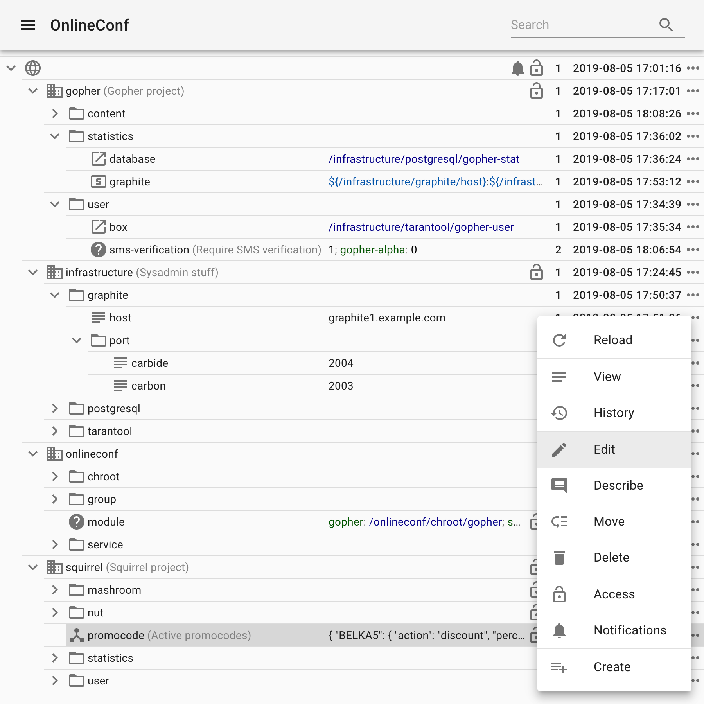

# OnlineConf

OnlineConf - это система конфигурирования уровня приложения, созданная для того, чтобы помочь разработчикам и менеджерам web-сервисов и приложений оперативно менять их поведение.

OnlineConf спроектирован с учетом требований горизонтальной масштабируемости и отказоустойчивости, рассчитан на хранение достаточно большого количества конфигурационных параметров. Чтение параметров конфигурации приложением осуществляется локально из memory mapped файлов, организованных в виде constant database, что не требует сетевых запросов и не вносит дополнительной точки отказа, а также позволяет эффективно читать только необходимые данные без парсинга файлов целиком.

Создателем OnlineConf является компания Mail.Ru, система успешно применяется с 2011 года для конфигурирования нагруженных проектов, развернутых на тысячах серверов.



## Особенности

* Доступность конфигурации вне зависимости от сетевой доступности/работоспособности OnlineConf;
* Быстрый индексированный доступ к параметрам конфигурации из приложения;
* Структурированное хранение конфигурации в виде дерева параметров;
* Поддержка как простых текстовых параметров, так и JSON/YAML;
* Поддержка символических ссылок на параметры (поведение аналогично симлинкам в Unix-системах);
* Возможность варьировать значение отдельных параметров и целых поддеревьев параметров в зависимости от hostname сервера, его расположения или реквизитов;
* Наличие панели управления, позволяющей модифицировать конфигурацию без наличия умений программиста, devops или системного администратора;
* Наличие API, позволяющего осуществлять автоматизированное изменение параметров;
* Возможность разграничивать доступ на чтение/запись как отдельных параметров, так и целых поддеревьев;
* Хранение истории изменения параметров, а также возможность подключить нотификации об изменении параметров;
* [Интеграция с Kubernetes](https://github.com/onlineconf/onlineconf-csi-driver).

## Установка

### Попробовать в Docker

Запустить базу данных, API и панель управления:

```sh
cd admin
docker-compose up
```

База данных будет инициализирована демонстрационным конфигом, панель управления и API будут доступны по адресу [localhost](http://localhost).

Демо показывает достаточно сложный случай, когда одна инсталляция OnlineConf используется для управления несколькими независимыми проектами (для одного проекта структура проще): *gopher* и *squirrel*. У каждого из проектов свой кластер серверов, на которых они развернуты, свои группы пользователей для управления.

Для демонстрационных целей созданы следующие пользователи (пароль совпадает с именем пользователя):

* `admin` - пользователь с полными правами (входит в группу `root`);
* `hedgehog` - системный администратор (группа `sysadmin`);
* `meerkat` - разработчик проекта gopher (группа `gopher-developer`);
* `rabbit` - разработчик проекта squirrel (группа `squirrel-developer`);
* `beaver` - менеджер проекта squirrel (группа `squirrel-manager`).

Принадлежность сервера к проекту в демо определяется по реквизитам, с которыми *onlineconf-updater* подключается к *onlineconf-admin* (см. ветку конфигурации `/onlineconf/service`, пароли совпадают с именами пользователей).

Запустить агент, обновляющий конфиги на конечном сервере:

```sh
cd updater
docker-compose up
```

По умолчанию запустится *onlineconf-updater* для проекта gopher, чтобы запустить агент для squirrel надо поправить реквизиты в [docker-compose.yml](updater/docker-compose.yml). Выгруженные конфигурационные файлы можно посмотреть в директории `./updater/data` на хост-машине (смонтирована в контейнер как `/usr/local/etc/onlineconf`).

Проекты gopher и squirrel специально сконфигурированы по-разному. Gopher следует по пути одного логически структурированного конфига, которым пользуется все сервисы, запущенные на сервере. Squirrel же, напротив, настроен таким образом, что у каждого сервиса на сервере свой отдельный конфигурационный файл.

### Запустить в production

Собрать, настроить и запустить сервисы `onlineconf-admin` и `onlineconf-updater` очень просто. Необходимая для запуска `onlineconf-admin` информация есть в [admin/docker-compose.yml](admin/docker-compose.yml), [admin/Dockerfile](admin/Dockerfile), а также в [admin/SPECS/onlineconf-admin.spec](admin/SPECS/onlineconf-admin.spec).
Для запуска `onlineconf-updater` см. аналогичные файлы в директории updater: [updater/docker-compose.yml](updater/docker-compose.yml), [updater/Dockerfile](updater/Dockerfile) и [updater/SPECS/onlineconf-updater.spec](updater/SPECS/onlineconf-updater.spec).

`onlineconf-admin` может либо быть расположен за reverse proxy (nginx, например), либо отдавать статику и терменировать TLS самостоятельно. В любом случае, для production использование TLS обязательно.

В случае, если OnlineConf используется для конфигурирования приложений, развернутых в Kubernetes, то вместо *onlineconf-updater* рекомендуется использовать [onlineconf-csi-driver](https://github.com/onlineconf/onlineconf-csi-driver).

## Архитектура

OnlineConf состоит из двух компонентов: `onlineconf-admin` и `onlineconf-updater`.

### onlineconf-admin

Основной компонент системы, реализующий всю логику работы с конфигурациями, предоставляет API для редактирования конфигурации, API для раздачи конфигурации на серверы, а также панель управления.

Для хранения данных используется БД MySQL, она привычна большинству системных администраторов, они умеют ее правильно настраивать, реплицировать, бэкапить.
Backend сервиса реализован на Go, frontend на TypeScript, взаимодействие между ними осуществляется по REST API, которое также можно использовать для автоматизации.

### onlineconf-updater

Демон, запускаемый на каждом из серверов, до которых необходимо доставлять конфигурацию. Отвечает за обновление локальных файлов конфигурации данными из onlineconf-admin. Периодически опрашивает onlineconf-admin на предмет наличия изменений и, если необходимо, записывает новую конфигурацию в локальные файлы в двух форматах: *conf* и *cdb*.

Формат *conf* исторический, появился в самой первой версии OnlineConf, рекомендуется его применять только для небольших конфигураций. Представляет собой простой текстовый файл, в котором в каждой строке записано имя параметра и его значение.

Поддержка формата *cdb* появилась в момент, когда стало понятно, что перечитывание конфигурации, при ее изменении, из текстового файла требует значительного времени. Рекомендуется использовать именно его, описание формата доступно на [сайте его автора](http://cr.yp.to/cdb.html)

Демон написан на Go, не имеет зависимостей и легко деплоится на любую систему.

## Типы данных

* Null - ключ не имеет значения, эквивалентно отсутствию ключа;
* Text - текст, может быть многострочным;
* JSON - поле в формате JSON;
* YAML - поле, хранимое, редактируемое и отображаемое в формате YAML. Приложение получит его преобразованным в формат JSON, это связано с более широкой поддержкой этого формата библиотеками разных языков;
* Template - шаблон текста, в который могут быть подставлены либо другие параметры конфигурации либо hostname/ip сервера, на который выгружается конфигурация, либо переменные, указанные в секции `variables` файла конфигурации *onlineconf-updater*;
* Symlink - символическая ссылка на другой параметр, аналог симлинков unix-систем;
* Case - работает как оператор switch, в зависимости от условия параметр принимает одно из значений;
* Различные виды списков: простой список через запятую, список пар ip:port через запятую и список пар ip:ports через точку с запятой (порты через запятую).

### Зашифрованные значения

Значение любого типа, кроме Null, Symlink и Case, может быть помечено как
**зашифрованное** (сам Case — нет, но каждая его ветка — да, включая
вложенные Case). Такое значение хранится в базе в виде конверта AES-256-GCM,
который `onlineconf-admin` создаёт ключом из своего файла ключей; так же
хранится и каждая его версия в журнале изменений: в момент, когда параметр
становится зашифрованным, его старые версии тоже запечатываются. Дампы,
резервные копии, реплики и учётные записи базы данных никогда не видят
открытого текста, как и побочные каналы админки: поиск по значениям
пропускает зашифрованные значения, уведомления об изменениях и лента бота
показывают замок вместо значения, в логах сервера печатается `<encrypted>`.

Шифрование — только при хранении. Управляемые серверы по-прежнему получают
открытый текст из `/client/config` (по TLS, обязательному в production), а
резолвер расшифровывает всё дерево в памяти. Оно не защищает от
скомпрометированного хоста админки, от пользователей, которым политика
показа разрешает показ, и от копий базы, снятых до того, как значение было
зашифровано.

**Чтение секрета — явное действие, которое записывается.** В любом списке
интерфейс и API отдают зашифрованное значение как `null`; открытый текст
возвращает только `GET /config/<path>?reveal=1` (а историю
параметра — `GET /log/<path>?reveal=1`) в соответствии с политикой показа
(см. `/onlineconf/value-encryption/reveal` ниже), и каждый такой запрос
записывается в журнал аудита (`my_config_audit`, виды `reveal_view` и
`reveal_history`) и сообщается владельцам параметра через бота
(`GET /botapi/audit/`, scope `audit`) и устаревшую таблицу
уведомлений. При записи зашифрованного параметра поле формы `encrypted`
(`1` или `0`) должно быть указано явно: клиент, не знающий о шифровании,
получает отказ, а не возможность затереть секрет тем `null`, который ему
отдали. Откат параметра к исторической версии выполняется на сервере
(`POST /config/<path>` с `version` и `restore=<version>`) и никогда не
снимает шифрование.

**Настройка.** Файл ключей — текстовый файл с одной строкой
`<key-id> <base64 от 32 случайных байт>` на ключ (строки с `#` —
комментарии); новая инсталляция шифрует первым ключом, а дальше — ключом,
отмеченным активным в реестре (см. *Ротация* ниже), независимо от порядка
строк; остальные ключи хранятся для расшифровки. Ключ создаётся командой
`head -c 32 /dev/urandom | base64`; файл должен быть доступен на чтение
только пользователю сервиса; путь к нему указывается в конфигурации админки:

```yaml
encryption:
  key_file: /usr/local/etc/onlineconf-admin.keys
```

либо задаётся переменной окружения `ONLINECONF_ENCRYPTION_KEY_FILE` (образ
Docker транслирует её в ту же настройку). Результат всегда виден в логе при
запуске: `encryption keyring loaded` с идентификатором активного ключа либо
`value encryption is not configured` — файл ключей, просто лежащий в
`/usr/local/etc/onlineconf-admin.keys`, упоминается в логе, но неявно не
загружается. Без ключа интерфейс не показывает переключатель
*Зашифровано*, а `/ui-config` отдаёт `"encryption": {"enabled": false,
"reveal": "rw"}` (`reveal` — политика показа, см. ниже). Экземпляр,
обнаруживший в базе зашифрованные значения без файла ключей, или ключ,
материал которого отличается от зарегистрированного в базе под тем же
идентификатором, отказывается запускаться; экземпляр, не сумевший
расшифровать значение при перезагрузке дерева, продолжает отдавать
последнюю удачно загруженную конфигурацию. У всех экземпляров одной
инсталляции должны быть одни и те же ключи.

**Ротация** не требует инструментов — только файл ключей и один
перезапуск. Добавьте новый ключ в файл ключей на всех экземплярах (любой
строкой: порядок строк важен только в новой инсталляции) и перезапустите
их. Когда ключ есть у всех экземпляров, запишите его идентификатор в
`/onlineconf/value-encryption/key-id`: экземпляр, принявший эту запись
(любой другой — в течение нескольких секунд, при перезагрузке дерева), в
фоне перешифрует все хранимые значения, не трогая версии, время изменения
и уведомления, и отметит новый ключ активным в реестре ключей
(`my_config_encryption_key`). `GET /encryption-status` (только для группы
root) показывает желаемый ключ, ключ, которым шифрует этот экземпляр, и
состояние перешифровки; когда перешифровка завершена, старый ключ можно
удалить из файлов при любом следующем деплое. Ключ, однажды бывший
активным, снова активным стать не может: ротация только вперёд.
Идентификатор, записанный раньше, чем ключ появился у всех экземпляров,
экземпляры без ключа отвергают (с записью в лог, ничего не меняя), а после
перешифровки они не смогут расшифровать записанное другими, пока не
получат ключ.

## Аутентификация

На данный момент поддерживается два метода аутентификации:

* `mysql` - реквизиты пользователя хранятся в таблице MySQL. Структура таблицы и метод хэширования пароля унаследованы и совместимы с модулем `mod_auth_mysql` для Apache httpd.

* `header` - аутентификация выполняется обратным прокси-сервером, развернутым перед `onlineconf-admin`. В параметре `header` можно указать имя HTTP-заголовка, который обратный прокси будет использовать для передачи имени пользователя (по умолчанию `X-Username`, для `oauth2-proxy`, например, следует использовать `X-Forwarded-Preferred-Username`). Если в параметре `secret` указать соль для подписи, то `onlineconf-admin` в HTTP-заголовке с именем `header + "-Sign"` (то есть `X-Username-Sign` по умолчанию) будет ожидать подпись, вычисленную как MD5 от конкатенации имени пользователя, ip пользователя и соли. При использование обратного прокси также необходимо выставить параметр конфигурации `behind_reverse_proxy` в секции `http` в значение `true`.

## Авторизация

Для каждого параметра можно задать, какая группа пользователей имеет право его просматривать и редактировать. Права дочерними параметрами дерева наследуются от родительских элементов. Делегирование доступа доступно тем же пользователям, которым доступно редактирование.

В системе есть специальная группа `root`, к ней привязаны некоторые дополнительные возможности, в том числе право на управление группами пользователей.

## Особые параметры

В дереве конфигурации OnlineConf есть специальная ветка `/onlineconf`. Она используется для конфигурирования поведения самого OnlineConf и позволяет делать некоторые интересные штуки.

### /onlineconf/module

`/onlineconf/module` - эта ветка важнейшая, именно она, а не корень дерева, является началом начал конфигураций, выгружаемых на серверы. Каждый непосредственный дочерний элемент этой ветки становится отдельным файлом конфигурации, а все поддерево этого дочернего элемента - содержимым файла.

В самом простом случае, эта ветка имеет один дочерний элемент - `/onlineconf/module/TREE`, значением которого является ссылка на корень дерева. Это приводит к тому, что на серверы выгружаются файлы `/usr/local/etc/onlineconf/TREE.{cdb,conf}`, содержащие все дерево OnlineConf. Но возможны и более интересные варианты.

Например, в качестве значения параметра `/onlineconf/module` можно использовать Case, который в зависимости от группы, к которой принадлежит сервер, будет иметь значением симлинк на разные поддеревья параметров. Это приведет к тому, что на эти серверы будут выгружены принципиально разные конфигурации. Этот подход удобно использовать для того, чтобы при помощи одной инсталляции OnlineConf управлять несколькими проектами.

Если на одном сервере сосуществуют несколько сервисов, для которых лучше иметь разные конфигурационные файлы, то в `/onlineconf/module` можно создать по поддереву для каждого из них.

Значения параметров `/onlineconf/module` и `/onlineconf/module/${modulename}` используются *onlineconf-updater* для конфигурирования выгрузки файлов, причем в `/onlineconf/module` можно сконфигурировать поведение для всех модулей, а в `/onlineconf/module/${modulename}` для конкретного. Значение должно быть типа YAML или JSON и содержать map параметров.
На данный момент поддерживаются параметры: `delimiter`, `owner`, `mode` и `child_lists`.

* `delimiter` позволяет сконфигурировать разделитель, используемый в именах параметров, который может принимать одно из значений: `/` или `.`. Для новых инсталляций OnlineConf рекомендуется задать разделитель явно (в `/onlineconf/module`), в противном случае будет использоваться режим совместимости, в котором для модуля `TREE` будет использоваться разделитель `/`, а для всех остальных - `.`.
* `owner` позволяет установить владельца конфигурационного файла на конечном сервере.
* `mode` позволяет установить права конфигурационного файла на конечном сервере.
* `child_lists` (bool) включает генерацию списков элементов для каждой непустой ветки. Имя такого списка - это имя ветки с добавленным разделителем (`delimiter`) в конце, значение - массив JSON, содержащий имена элементов. Если параметр `child_lists` отсутствует, либо равен `false`, то списки элементов не передаются.

### /onlineconf/service

`/onlineconf/service` - дерево аккаунтов, под которыми могут авторизовываться *onlineconf-updater*. Также служат одним из условий для Case. Имя параметра - имя пользователя (или его последняя часть), значение - SHA256 от пароля. Для защиты от атак с применением радужных таблиц пароль ДОЛЖЕН быть достаточно длинной последовательностью случайных символов (минимум 16).
Вложенные сервисы наследуют конфигурацию от своих родителей, позволяя для отдельных необходимых параметров указать более специфичный Case и переопределить значение родителя.
Имя аккаунта дочерних сервисов формируется как часть пути за вычетом префикса `/onlineconf/service/`, например: `gopher/alpha`.

### /onlineconf/group

`/onlineconf/group` - группировка серверов и сервисов по имени. Имя параметра - имя группы, значение - *glob* (примерно как в `bash`) hostname серверов, входящих в эту группу, или имен сервисов с префиксом `service:` (например: `service:gopher/alpha`). Синтаксис глобов описан [здесь](https://github.com/bmatcuk/doublestar#patterns). Например: `{alpha*.{example.com,i},service:gopher/alpha}` - включает сервера с hostname `alpha*.example.com`, `alpha*.i` (где `*` - любые символы кроме `.`) и сервис `gopher/alpha`.

`/onlineconf/group/priority` - список групп через запятую в порядке убывания приоритета. По умолчанию группы сортируются по алфавиту, все неуказанные в данном списке группы добавляются либо в конец списка либо вместо плейсхолдера `*`. Приоритеты нужны в тех случаях, когда сервер одновременно входит в несколько групп, для которых какой-либо из параметров имеет разное значение.

### /onlineconf/datacenter

`/onlineconf/datacenter` - группировка серверов по ЦОД. Имя дочернего параметра - имя ЦОД, значение - либо типа `Null`, либо список сетей через запятую типа `Text` или `List`. В первом случае имя датацентра будет принято от *onlineconf-updater* (параметр `datacenter` в его конфиге `onlineconf.yaml`), во втором - вычислено исходя из IP адреса, с которого пришел *onlineconf-updater*.

### /onlineconf/suspended

`/onlineconf/suspended` - приостановить выгрузку обновлений конфигурации на серверы в случае, если значение истинно (не типа `Null`, не `""` и не `"0"`). Удобно использовать для того, чтобы организовывать транзакционное изменение множества параметров. Начало транзакции - установка этого параметра в истину, конец - в ложь. Также можно использовать для того, чтобы опасные правки конфигурации испытывать на небольшом наборе серверов.

### /onlineconf/ephemeral-ip

`/onlineconf/ephemeral-ip` - список сетей, в которых IP адреса выдаются динамически на время существования сервиса (например, в кластере Kubernetes). Для этих сетей не выполняется обратный DNS запрос и не осуществляется мониторинг.

### /onlineconf/ui/avatar

`/onlineconf/ui/avatar` - конфигурация аватарок, отображаемых в UI OnlineConf, в формате JSON или YAML со следующей схемой:

* `uri` - общая часть URI аватарок, `/` и имя пользователя будет добавлены в конец;
* `domain` - имя домена пользователей, если присутствует, то будет добавлено к имени пользователя после `@`;
* `gravatar` - если true, то перед подстановкой в URI имя пользователя будет захэшировано MD5;
* `extension` - расширение файла, если присутствует, то будет добавлено к URI после `.`;
* `rename` - `map[string]string`, словарь замен имен пользователей для подстановки в URI аватарок;
* `link` - объект настройки гиперссылки на профиль пользователя:
  * `uri` - общая часть URI профиля пользователя, `/` и имя пользователя будет добавлены в конец;
  * `rename` - `map[string]string`, словарь замен имен пользователей для подстановки в URI профилей;

Симлинки в этом параметре намеренно не поддерживаются, допустимо использовать только типы JSON и YAML.
Значение параметра неявно будет доступно на чтение всем пользователям через метод API `/ui-config`.

### /onlineconf/botapi/bot

Дочерние параметры `/onlineconf/botapi/bot` - пользователи серверного API OnlineConf. Имена параметров - это имена пользователей, значения - пароли (должны быть случайными последовательностями символов длинной не меньше 16), закодированные в SHA256. Эти параметры могут иметь подпараметры `scopes` (`/onlineconf/botapi/bot/*/scopes`) типа List, которые используются для того, чтобы разрешить доступ к определенным частям API.

### /onlineconf/disable-deleted-key-symlinks-check

При удалении параметра производится проверка наличия симлинков и шаблонов, ссылающихся на этот параметр. Если таковые обнаружены (включая симлинки и шаблоны внутри кейсов),
удаление не производится, и выдаётся ошибка с указанием этих симлинков/шаблонов. Эта проверка является лишь "защитой от дурака" и не предоставляет полную гарантию корректности
симлинков (например, проверяются только 5 первых ссылающихся друг на друга симлинков, вложенные кейсы не поддерживаются). В некоторых редких случаях, например, при наличии симлинков,
ссылающихся на родительские папки, при удалении параметра может возникнуть заметная задержка.

Для отключения этой проверки следует установить `/onlineconf/disable-deleted-key-symlinks-check` в любое непустое текстовое значение, отличное от `0`.

### /onlineconf/value-encryption

`/onlineconf/value-encryption` разрешает запись зашифрованных значений (см.
*Зашифрованные значения* выше), если содержит непустое текстовое значение,
отличное от `0`, **и** у экземпляра есть файл ключей. В новых инсталляциях
параметр создаётся со значением `1`. В обновлённой инсталляции параметра
нет, и возможность остаётся выключенной — применение одной лишь миграции
схемы ничего не меняет — пока оператор не создаст его, убедившись, что все
экземпляры работают на версии, понимающей зашифрованные значения, и имеют
файл ключей: старый экземпляр отдал бы хранимый конверт как значение.
Последующее выключение запрещает только новые зашифрованные записи; показ и
расшифровка обратно в открытый текст (`encrypted=0`) продолжают работать,
так что ни один параметр не оказывается в ловушке.

`/onlineconf/value-encryption/reveal` задаёт, кто может показать
зашифрованное значение: `rw` (по умолчанию, в том числе при отсутствии
параметра) требует права записи в параметр, `ro` позволяет показ любому,
кто имеет право чтения. Оба параметра — простой текст, читаются по пути
(симлинки раскрываются, права доступа не проверяются) и сами не должны
быть зашифрованы. Изменение политики показа вступает в силу сразу на
экземпляре, принявшем запись, и в течение нескольких секунд — при
следующей перезагрузке дерева — на остальных.

`/onlineconf/value-encryption/key-id` — читается так же — называет по
идентификатору из файла ключей ключ, которым выполняются новые шифрования;
запись нового идентификатора в него и есть ротация ключа (см. *Ротация*
выше). Какой ключ используется, в порядке приоритета:

1. ключ, названный этим параметром, если параметр есть и не пуст;
2. иначе ключ, отмеченный активным в реестре ключей
   (`my_config_encryption_key`): ключ последней ротации, а в инсталляции,
   где ротаций не было, — тот, что был первой строкой файла ключей при
   первом запуске инсталляции с шифрованием;
3. иначе — новая инсталляция, в реестре ещё ничего нет — первый ключ файла
   ключей, который в этот момент и отмечается активным.

Порядок строк файла ключей важен только в случае 3, но используемый ключ в
файле быть обязан: экземпляр, в файле которого его нет, отказывается
запускаться, а работающий экземпляр без него (ротация, ключ которой ему не
выдали) отвечает на зашифрованные записи ошибкой `EncryptionKeyMissing`.
`GET /encryption-status` показывает используемый ключ и его источник
(`wanted`: `parameter`, `registry` или `key file`).

## Чтение конфигурации из приложения

Для нескольких языков уже есть готовые библиотеки: [Go](https://github.com/onlineconf/onlineconf-go), [Swift](https://github.com/onlineconf/onlineconf-swift), [Perl](https://github.com/onlineconf/onlineconf-perl), [Python](https://github.com/onlineconf/onlineconf-python) и [Node.js](https://github.com/onlineconf/onlineconf-nodejs).

Но, если необходимо это делать из другого языка, то это просто, достаточно, чтобы для него была библиотека работы с файлами в формате CDB. Алгоритм чтения параметров примерно такой:

* Если CDB-файл еще не открыт, то открыть на чтение, он будет c`mmap`лен в память, запомнить его `mtime`, если открыт, то сверить сохраненный `mtime` со временем файла на диске и, если не совпадает, то переоткрыть и сбросить кэши десериализованных JSON.
* Прочитать ключ по имени параметра. В первом байте значения - идентификатор типа: `s` - текстовое поле, `j` - JSON. В остальных - собственно значение.
* Для строки - отдать приложению ее копию, для JSON - десериализовать и отдать структуру, закэшировать ее.

## Общие рекомендации

OnlineConf в силу наличия симлинков и кейсов обладает большой гибкостью. За время использования этой системы в Mail.Ru у нас выработались некоторые правила организации дерева конфигурации, которые могут оказаться удобными не только для нас:

* *Размещение параметров в дереве, исходя из закладываемой в них логики, а не из того, как их надо выгружать в файлы.* Параметры лучше группировать в дереве логически, это упрощает понимание конфигурации и делегирование прав. Для того же, чтобы добиться правильного размещения параметров по файлам, использовать симлинки. Это особенно актуально для параметров, которые используются из разных подсистем.

* *На верхнем уровне дерева каждый элемент соответствует отдельному проекту. Каждому проекту свой chroot.* В `/onlineconf/module` размещается Case из симлинков, для каждого из проектов ведущих в свой `/onlineconf/chroot/${projectname}`. В `/onlineconf/chroot/${projectname}/TREE/${projectname}` размещается ссылка на `/${projectname}`. Это приводит к тому, что у каждого проекта своя конфигурация и при этом пути к параметрам в файле на сервере и в дереве OnlineConf совпадают.

* *Инфраструктура отдельно.* Параметры, которыми должны управлять системные администраторы (адреса баз, сервисов, реквизиты, токены и пр.), размещаются в отдельной иерархии `/infrastructure`. Эта иерархия доступна на чтение и запись только системным администраторам, напрямую нигде не используется, только через симлинки из нужных мест в логической иерархии проектов.

## BotAPI

Помимо клиентского API, которое использует UI, OnlineConf также имеет серверное API, которое могут использовать различные скрипты и демоны для выполнения специфичных операций.

Для ограничения доступа к BotAPI используется BasicAuth, который настраивается параметрами `/onlineconf/botapi/bot` (см. выше).

### GET /notification/

Возвращает `limit` последних уведомлений начиная со следующего после `lastID`.
Если уведомлений нет и передан параметр `wait`, то ждет максимум `wait` секунд до появления нового уведомления.
Если `limit=0`, то метод просто возвращает текущий `lastID`.

Для доступа к этому методу необходим scope `notifications`.

### GET /audit/

Возвращает `limit` событий журнала аудита начиная со следующего после `lastID`; параметры `wait` и `limit=0` работают так же, как у `GET /notification/`.
Событие — `{"id", "path", "user", "kind", "mtime", "notification", "users"}`: кто и что сделал (`kind`: `reveal_view` — показано текущее значение зашифрованного параметра, для просмотра или редактирования; `reveal_history` — показана его история) с каким параметром, а также настройка уведомлений параметра и пользователи, которым нужно сообщить, — так же, как в уведомлении.
События параметров с настройкой уведомлений `none` не отдаются. Ответ — `{"events": [...], "lastID": N}`.

Для доступа к этому методу необходим scope `audit`.
